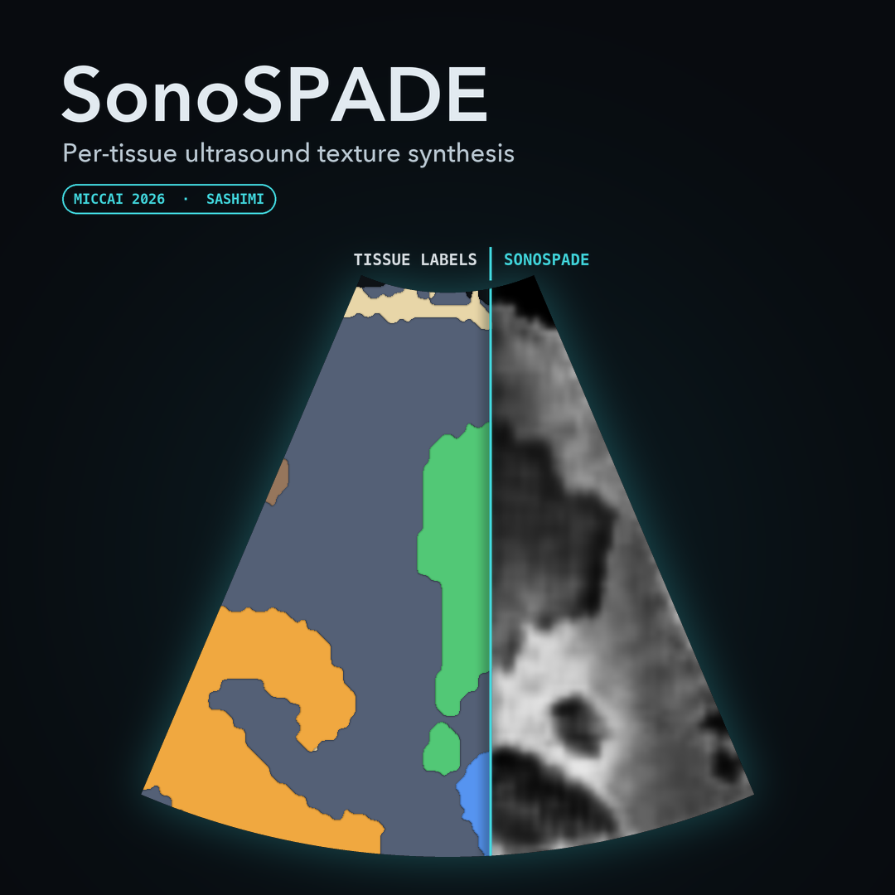
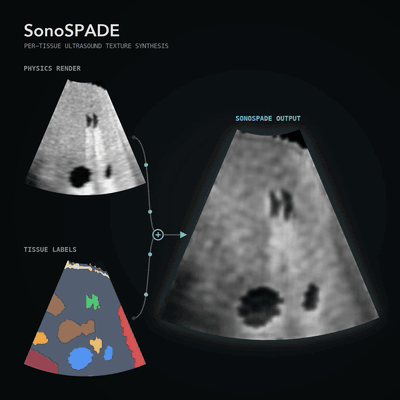

# SonoSPADE

**Real-time, GPU-free, per-tissue ultrasound texture synthesis for closed-loop acquisition.**

<p align="center">
  
  
</p>

<p align="center"><sub>One patient (gallbladder view), rendered with the checkpoint of the SASHIMI
paper.</sub></p>

SonoSPADE is a physics-conditioned, *per-tissue* ultrasound texture stage: it refines a physics
B-mode render into realistic ultrasound under spatially-adaptive conditioning from the **tissue label
slice**, trained **unpaired with no real annotations**. A single generator pass runs at **15–85 fps
without a GPU**, two to three orders of magnitude faster (per frame) than a semantic-diffusion
synthesizer, so it can sit inside a closed-loop reinforcement-learning acquisition simulator, where a
new frame must be rendered at every agent step.

---

## Why per-tissue?

Global sim-to-real translators (CycleGAN, CUT) apply one appearance map to the whole image, so they
cannot guarantee that *liver reads as liver and kidney as kidney*. SonoSPADE conditions the generator
on **both** the physics render (content) **and** the label map (per-tissue modulation, via SPADE), and
supervises it with a segmenter pretrained for free on aligned simulator pairs (frozen, it pseudo-labels
the unlabeled real pool for an OASIS discriminator and enforces a per-tissue consistency loss). Relabel
a region and only *its* texture changes.

## Key results (honest)

| Property | SonoSPADE | Best global recolor | Note |
|---|---|---|---|
| **Label-swap locality** (per-tissue control) | **≈ 26** | 0 | 0 for every label-free translator by construction |
| **Per-organ intensity W₁** (↓, real match) | **0.119** | 0.246 (CUT) | best among *learned* translators |
| **Structure preservation** (edge-IoU, ↑) | **0.41** | 0.17 | 2.4× the best baseline |
| Whole-frame **FID/KID** | loses *by design* | wins | these reward the global recolor SonoSPADE does not perform |
| **Latency** (CPU / iGPU, single pass) | **66 / 12 ms** | ~same | diffusion is 133×–665× slower **per frame** at standard T |
| **Downstream TSTR** (train-on-synthetic Dice) | overtakes raw render on every seed | n/a | only after matching sector geometry + test-time adaptation; absolute Dice stays low |

All numbers are on the **public** [Kaggle *ussimandsegm* (Vitale et al.)](https://www.kaggle.com/datasets/ignaciorlando/ussimandsegm)
abdominal ultrasound set, with simulator content from open [TotalSegmentator](https://github.com/wasserthal/TotalSegmentator)
CT (see [Data](#data)).

## Repository layout

```
src/usbg/            the SonoSPADE code (historical package name, kept so imports match the release)
  texture_gan.py       SonoSPADE generator + trainer + CUT/CycleGAN baselines + inference translators
  segmenter.py         S_US: the free frozen segmenter (pseudo-labels + consistency)
  texture_eval.py      per-tissue metrics (locality, organ-W1, speckle SNR, TSTR)
  volume.py            CT → canonical tissue label volume + acoustic tables
  render_lotus.py      label slice → physics B-mode (pure torch/numpy; the SonoSPADE substrate)
  slicer.py, placement.py   probe pose → 2D label slice; organ-centred pose seating
  _vendor/             self-contained SE(3) geometry + scan geometry (vendored; no external repo needed)
scripts/             training, evaluation, and experiment drivers
paper/               SASHIMI submission package: LNCS source + compiled main_sashimi.pdf,
                     supplementary.pdf, figures, bibliography (README.txt = build steps)
docs/                SONOSPADE.md (method notes), WEIGHTS.md (model card for the released checkpoints)
configs/             sonospade.yaml (hyperparameters)
data/                README with data-download / regeneration instructions (data itself not shipped)
weights/             MANIFEST.json (checksums); scripts/fetch_weights.py downloads the checkpoints here
```

## Install

```bash
python -m venv .venv && source .venv/bin/activate
pip install -e .            # core (texture synthesis + evaluation)
pip install -e ".[viz]"     # + figures / previews
```
Runs on CPU or Apple-Silicon MPS (`export PYTORCH_ENABLE_MPS_FALLBACK=1`); no discrete GPU required.
The import package is `usbg`; SonoSPADE is `usbg.texture_gan` (+ `usbg.segmenter`).

## Pretrained weights

The trained checkpoints are attached to the
[v0.2.0 release](https://github.com/tohnperfect/SonoSpade/releases/tag/v0.2.0). The download script
checks each file's SHA-256 against [`weights/MANIFEST.json`](weights/MANIFEST.json):

```bash
python scripts/fetch_weights.py --set sashimi   # the paper's checkpoints (4 files, ~141 MB)
python scripts/fetch_weights.py --set usbgym    # the texture stage USB Gym used (2 files, ~71 MB)
```

| Set | Generator | Segmenter `S_US` | Use it for |
|---|---|---|---|
| SASHIMI paper | `sonospade_sashimi_linear.pt`, `sonospade_sashimi_curvi.pt` | `s_us_sashimi_linear.pt`, `s_us_sashimi_curvi.pt` | this paper's experiments; linear or curvilinear frames |
| USB Gym | `sonospade_usbgym_curvi_s0.pt` | `s_us_usbgym_curvi_s0.pt` | [USB Gym](https://github.com/tohnperfect/USBGym); its training CTs exclude USB Gym's test patients |

Only the generator is needed to make frames. Training data, intended use, limits and licensing are
in the model card, [`docs/WEIGHTS.md`](docs/WEIGHTS.md). For research simulation only, not clinical
use.

## Quickstart

```python
import numpy as np, usbg.volume as V, usbg.render_lotus as R
from usbg.texture_gan import load_translator          # dual-input aware loader

lv  = V.synthetic_phantom()                            # a labeled phantom (no download)
lab = lv.labels[lv.labels.shape[0] // 2]               # a 2D label slice
phys = R.render(np.asarray(lab), renderer="physics")   # physics B-mode render
son  = load_translator("weights/sonospade_sashimi_linear.pt")   # from fetch_weights.py, or your own
real_like = son.translate_aligned(phys, lab)           # per-tissue-textured frame
```

## Data

Everything runs on **public** datasets; no private data is required or shipped. See
[`data/README.md`](data/README.md) for download/ingest of the Kaggle *ussimandsegm* real ultrasound
set and the TotalSegmentator CT content.

## Train your own

```bash
export PYTORCH_ENABLE_MPS_FALLBACK=1
# 1. aligned (physics render, label) pairs from TotalSegmentator CTs in data/raw/totalseg_small/
python scripts/make_dataset.py --cases s0011 s0058 s0344 s0358 s0461 s0477 s0511 s0513 \
    --n-per-case 110 --out data/dataset/pairs_med.npz
# 2. the frozen segmenter S_US (simulated pairs only)
python scripts/train_segmenter.py --pairs data/dataset/pairs_med.npz --group --out data/dataset/s_us_grouped.pt
# 3. the real pool and the labelled real test set from Kaggle ussimandsegm
python scripts/ingest_kaggle_us.py --src /path/to/ussimandsegm
# 4. SonoSPADE
python scripts/train_texture_gan.py --variant sonospade --pairs data/dataset/pairs_med.npz \
    --real-dir data/real/kaggle_vitale/pool --s-us data/dataset/s_us_grouped.pt \
    --iters 1500 --out data/dataset/exp_real_sonospade.pt
```

A retrained model is not bit-identical to the released one (random seeds, hardware).

## Reproduce the paper

```bash
export PYTORCH_ENABLE_MPS_FALLBACK=1
# after steps 1-4 above: SonoSPADE (+ baselines when their inputs exist) -> per-tissue metrics
bash scripts/run_sonospade_experiment_real.sh
# downstream transfer (geometry remap + test-time adaptation)
python scripts/curvi_warp.py ; python scripts/eval_tta_tent.py
# latency (measured): SonoSPADE vs a representative diffusion U-Net, same hardware
python scripts/bench_latency.py ; python scripts/bench_diffusion_latency.py
```

## Closed-loop acquisition RL

The paper reports a brief in-the-loop proof of concept (an agent whose reward is a real-trained organ
recognizer). The full closed-loop RL study (method, seeds, and the multi-organ analysis) is **not
included in this release**; see [`scripts/closed_loop_rl/README.md`](scripts/closed_loop_rl/README.md).

## How to cite

The paper is published in the MICCAI 2026 workshop proceedings (11th SASHIMI workshop, LNCS 17258):
[open-access page](https://papers.miccai.org/miccai-2026-sat/SASHIMI_035.html),
[PDF](https://papers.miccai.org/miccai-2026-sat/paper/SASHIMI_035.pdf),
[supplementary material](https://papers.miccai.org/miccai-2026-sat/supp/SASHIMI_035_supp.pdf).

If you use this code or ideas, please cite the paper and link this repository:

```bibtex
@inproceedings{sonospade2026,
  title     = {{SonoSPADE}: Real-Time, Per-Tissue Ultrasound Texture Synthesis for Closed-Loop Acquisition},
  author    = {Intharah, Thanapong and Gao, Zhichao and Dong, Hao},
  booktitle = {Medical Image Computing and Computer Assisted Intervention -- MICCAI 2026 Workshops and
               Challenges (SASHIMI)},
  series    = {Lecture Notes in Computer Science},
  volume    = {17258},
  publisher = {Springer Nature Switzerland},
  address   = {Cham},
  year      = {2026},
  url       = {https://papers.miccai.org/miccai-2026-sat/SASHIMI_035.html}
}
```

## Limitations

Unpaired training matches per-tissue *statistics*, not exact speckle: this is training texture, not
diagnostic imagery. Acoustically similar soft tissues are near-inseparable in B-mode. Validation is a
single dataset/anatomy (abdominal Kaggle, 60 annotated real frames). See the paper's Limitations.

## Acknowledgements & license

Built on LOTUS-style physics rendering and [TotalSegmentator](https://github.com/wasserthal/TotalSegmentator)
CT labels; evaluated on the public [Kaggle *ussimandsegm*](https://www.kaggle.com/datasets/ignaciorlando/ussimandsegm)
(Vitale et al.) ultrasound set. `src/usbg/_vendor/` contains self-contained copies of the authors' SE(3)
and B-mode scan geometry so the release runs with no external repo. Released under the terms in
[`LICENSE`](LICENSE).
